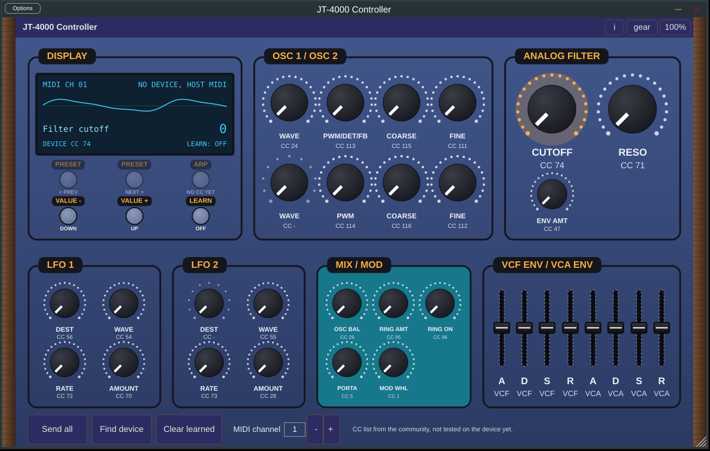

# JT-4000 Controller 🐈

Controller plugin for the Behringer JT-4000 (JT-4000M MICRO) (VST3 and standalone).

**Manual:** [PDF, opens in the browser](https://github.com/SpeakingColors/jt4000-vst/blob/main/docs/jt4000-vst-manual.pdf)

## Status
**Early build v0.2 (pre-release on the Releases page).** A MIDI controller plugin (VST3 and standalone) that sends and receives the CC messages listed in [map/params.csv](map/params.csv).

- Auto-connect (v0.2): the plugin looks for a JT-4000 among the system MIDI ports (name contains JT-4000) and talks to it directly; otherwise it uses the DAW MIDI output. The port name is not documented and **not tested with a real device yet**.
- Panel editor (v0.2): knobs, an OLED style display with a scope trace, LED buttons and MIDI learn. Controls with no known CC (OSC2 Wave, LFO2 destination, envelope faders, arp, presets) are drawn but do nothing.
- 22 parameters, taken from: Behringer JT-4000 MICRO (community CC list, not from a Behringer manual). 
- **None are tested on the real device yet.** The map only holds what the source above lists; ranges the manual does not print are assumed to be 0 to 127 and are marked that way in the plugin.
- The CC list comes from midi.guide (CC BY-SA 4.0) and a free web editor page; one conflict (OSC2 Wave 25 vs 22) is still open.
- No SysEx and no patch librarian yet. Nothing is sent that is not in the map.
- Not tested in a DAW yet. Builds in CI on Linux, Windows and macOS.

How it behaves: every entry is an automatable parameter. Moving it sends MIDI to the device, and incoming CC from the device moves it; incoming CC is consumed, never echoed back. At most 16 parameters are sent per audio block so the device is not flooded. Turn on CC receive and transmit on the device.

Build: `sh tests/run.sh` runs the pure C++ tests (no JUCE needed). The plugin needs JUCE 8: clone it into `third_party/JUCE`, then `cmake -B build && cmake --build build`. Changing a parameter means editing `map/params.csv` only.

  

☕ Free and open source, made by one person. If it helps your music, a coffee on [Ko-fi](https://ko-fi.com/studio87) keeps it coming. 💜

## Docs
- [Device notes](docs/DEVICE-NOTES.md): what is confirmed from manuals, and what is still missing.
- [Roadmap](ROADMAP.md)

## License
AGPL-3.0-or-later, see [LICENSE](LICENSE).

Not affiliated with or endorsed by Behringer or Music Tribe. All trademarks belong to their owners.
